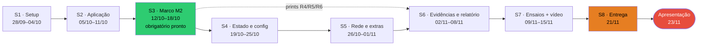
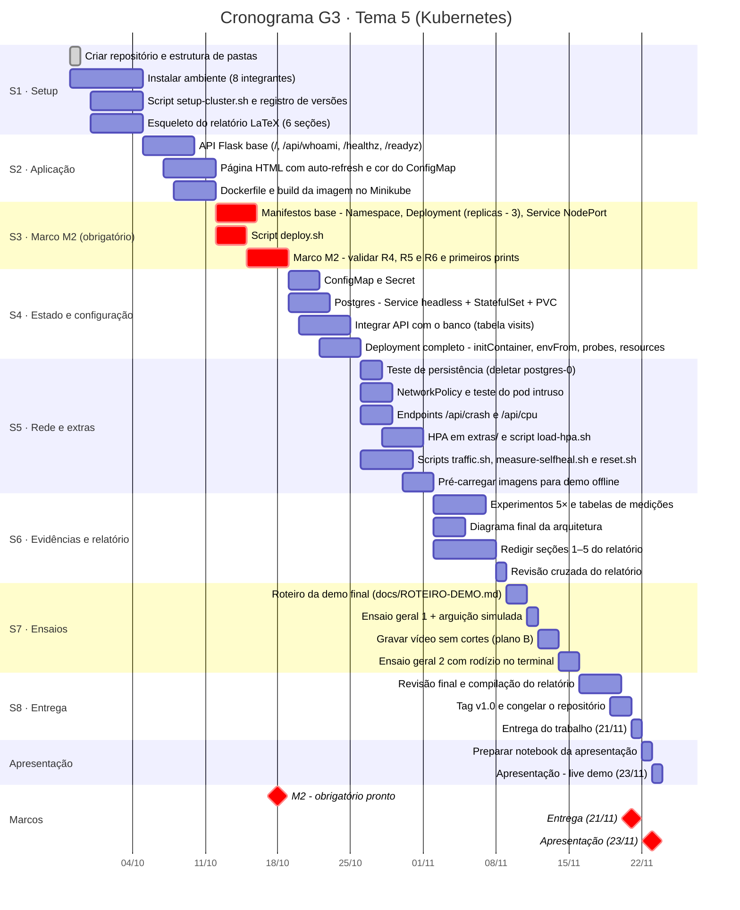

# Cronograma

Linha do tempo do trabalho (Prática 5, Kubernetes). A fonte da verdade do andamento é o **Project (Board/Roadmap)**; este arquivo mostra a visão geral.

## Fluxo das fases

## Linha do tempo (Gantt)

Barras vermelhas: caminho crítico do obrigatório (marco M2).

## Marcos (milestones)

| Milestone | Prazo | Objetivo |
|---|---|---|
| S1 · Setup | 04/10 | Repositório, ambiente de todos e esqueleto do relatório. |
| S2 · Aplicação | 11/10 | API Flask, página HTML e imagem Docker. |
| S3 · Marco M2 (obrigatório) | 18/10 | Deployment + Service no ar e validação R4/R5/R6 ok. |
| S4 · Estado e configuração | 25/10 | Postgres com PVC, ConfigMap/Secret, dependência e probes. |
| S5 · Rede e extras | 01/11 | NetworkPolicy, HPA, endpoints extras, scripts e demo offline. |
| S6 · Evidências e relatório | 08/11 | Medições, diagrama e redação do relatório. |
| S7 · Ensaios | 15/11 | Roteiro final, ensaios e vídeo plano B. |
| S8 · Entrega | 21/11 | Revisão final, tag v1.0 e entrega (21/11). |
| Apresentação | 23/11 | Preparação do notebook e live demo (23/11). |

> Detalhes de cada tarefa: issues do repositório e `docs/PLANO.md` §9.
