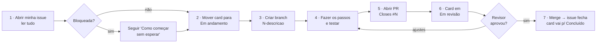

# Fluxo de trabalho do grupo

> Objetivo: **cada um toca sua parte sozinho**, do início ao fim, sem precisar perguntar nada.
> Tudo que você precisa está na sua issue, em [`CONTRATOS.md`](CONTRATOS.md) e no [`PLANO.md`](PLANO.md).

## 1. Ciclo de uma tarefa (sempre igual)



### Comandos
```bash
git switch main && git pull
git switch -c 12-api-base            # número da issue + descrição curta
# ... trabalha ...
git add -A && git commit -m "#12 rotas /healthz e /readyz"
git push -u origin 12-api-base
gh pr create --fill --body "Closes #12"   # ou pelo site
```

## 2. Regras simples
1. **Um PR por issue.** O PR fecha a issue com `Closes #N`.
2. **Ninguém faz push direto na `main`.** Tudo entra por PR.
3. **Revisão:** o revisor da sua issue está no topo dela. Revisar = rodar e conferir o "Como testar". Prazo de **48 h** para revisar.
4. **Critério de pronto:** o "Critério de pronto" da issue é cumprido **e** o PR foi aprovado.
5. **Siga o `CONTRATOS.md`.** Nome, porta, variável, formato de CSV: está tudo lá.
6. **Evidências sempre:** tirou print ou mediu algo? Salve em `relatorio/` com o nome do contrato. O relatório vale 2,5 pts.

## 3. Quem revisa quem

| Autor | Revisor |
|---|---|
| João Pedro | Hugo |
| Hugo | João Pedro |
| João Vitor | João Pedro |
| Ahmed | Hugo |
| Lucas | João Pedro |
| Bernardo | Ahmed |
| Luiz | Lucas |
| Thallys | Lucas |

## 4. Travou? Nesta ordem
1. Releia a seção **"Dicas e armadilhas"** da sua issue.
2. Rode `kubectl describe pod <pod> -n ha-demo`, `kubectl logs <pod> -n ha-demo` e `kubectl get events -n ha-demo`. 90% das respostas estão aí.
3. Consulte o **Material de apoio** da issue.
4. Ainda travado depois de ~1 h? **Comente na issue** o que tentou e o erro, e marque seu revisor. Comentar na issue é melhor que mandar mensagem no WhatsApp, porque fica registrado para o relatório.

## 5. Ritmo semanal
- **Domingo:** cada um comenta na sua issue aberta: *feito / próximo passo / bloqueio*. Leva 2 minutos.
- **Segunda:** mover para **A fazer** as issues da semana que começa (veja a milestone).
- Terminou antes? Pegue um item do Backlog **sem responsável** ou ajude quem está bloqueado.

## 6. Status no Board
| Coluna | Quando |
|---|---|
| Backlog | Ainda não é a semana dela |
| A fazer | É a semana dela e não comecei |
| Em andamento | Estou trabalhando (tenho branch) |
| Em revisão | PR aberto |
| Concluído | PR aprovado e com merge |
