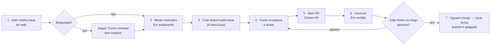

# Fluxo de trabalho do grupo

> Objetivo: **cada um toca sua parte sozinho**, do início ao fim, sem precisar perguntar nada.
> Tudo que você precisa está na sua issue, em [`CONTRATOS.md`](CONTRATOS.md) e no [`PLANO.md`](PLANO.md).

## 1. Ciclo de uma tarefa (sempre igual)



### Criando a branch (sempre a partir da issue)
**Pelo site:** abra a issue → barra lateral **Development** → **Create a branch** → *Checkout locally*. O GitHub gera o nome certo (`12-api-flask-base...`) e já liga a branch à issue.

**Pelo terminal:**
```bash
gh issue develop 12 --checkout        # cria a branch a partir da issue 12 e já troca para ela
# ... trabalha ...
git add -A && git commit -m "rotas /healthz e /readyz"
git push -u origin HEAD
gh pr create --fill                  # o título vira "#12 ..." e o "Closes #12" entra sozinho
```

## 2. Regras (o GitHub **obriga**, não dá para pular)

| Regra | Como é garantida |
|---|---|
| Ninguém faz push direto na `main` | Ruleset `main-protegida` |
| Toda branch nasce de uma **issue aberta**: nome `<número>-descricao` | Check `regras-do-pr` reprova o PR se não for |
| PR tem título `#N ...` e `Closes #N` | Check `regras-do-pr` **corrige sozinho** |
| Merge só com **aprovação do João Pedro ou do Hugo** | `CODEOWNERS` + ruleset (os dois são chamados automaticamente) |
| Commit novo depois da aprovação → precisa aprovar de novo | Ruleset (aprovação antiga é descartada) |
| Comentários da revisão resolvidos antes do merge | Ruleset |
| Merge só por **squash** (1 commit por issue na `main`) e a branch é apagada depois | Configuração do repositório |

Ninguém fura as regras, nem os admins. PR de João Pedro é aprovado pelo Hugo, e vice-versa.

Outras boas práticas (não obrigatórias, mas esperadas):
1. **Um PR por issue.**
2. **Rodar o "Como testar" da issue** antes de pedir revisão e colar o resultado no PR.
3. **Siga o `CONTRATOS.md`.** Nome, porta, variável, formato de CSV: está tudo lá.
4. **Evidências sempre:** tirou print ou mediu algo? Salve em `relatorio/` com o nome do contrato.

## 3. Aprovação dos PRs
- **Quem aprova:** **João Pedro** (@JohnPss) ou **Hugo** (@hugnarok). Qualquer um dos dois basta.
- **Prazo:** até **48 h** depois de o PR ser aberto.
- **Revisão entre colegas (opcional, recomendada):** qualquer integrante pode comentar e sugerir em qualquer PR. Isso ajuda a todos a conhecer o projeto inteiro para a arguição, mas não libera o merge.

## 4. Travou? Nesta ordem
1. Releia a seção **"Dicas e armadilhas"** da sua issue.
2. Rode `kubectl describe pod <pod> -n ha-demo`, `kubectl logs <pod> -n ha-demo` e `kubectl get events -n ha-demo`. 90% das respostas estão aí.
3. Consulte o **Material de apoio** da issue.
4. Ainda travado depois de ~1 h? **Comente na issue** o que tentou e o erro, e marque @JohnPss ou @hugnarok. Comentar na issue é melhor que mandar mensagem no WhatsApp, porque fica registrado para o relatório.

## 5. Ritmo semanal
- **Domingo:** cada um comenta na sua issue aberta: *feito / próximo passo / bloqueio*. Leva 2 minutos.
- **Segunda:** mover para **A fazer** as issues da semana que começa (veja a milestone).
- Terminou antes? Pegue um item do Backlog **sem responsável** ou ajude quem está bloqueado.

## 6. Status no Board
| Coluna | Quando |
|---|---|
| Backlog | Ainda não é a semana dela |
| A fazer | É a semana dela e não comecei |
| Em andamento | Estou trabalhando (tenho branch) |
| Em revisão | PR aberto, aguardando aprovação do João Pedro ou do Hugo |
| Concluído | PR aprovado e com merge |
