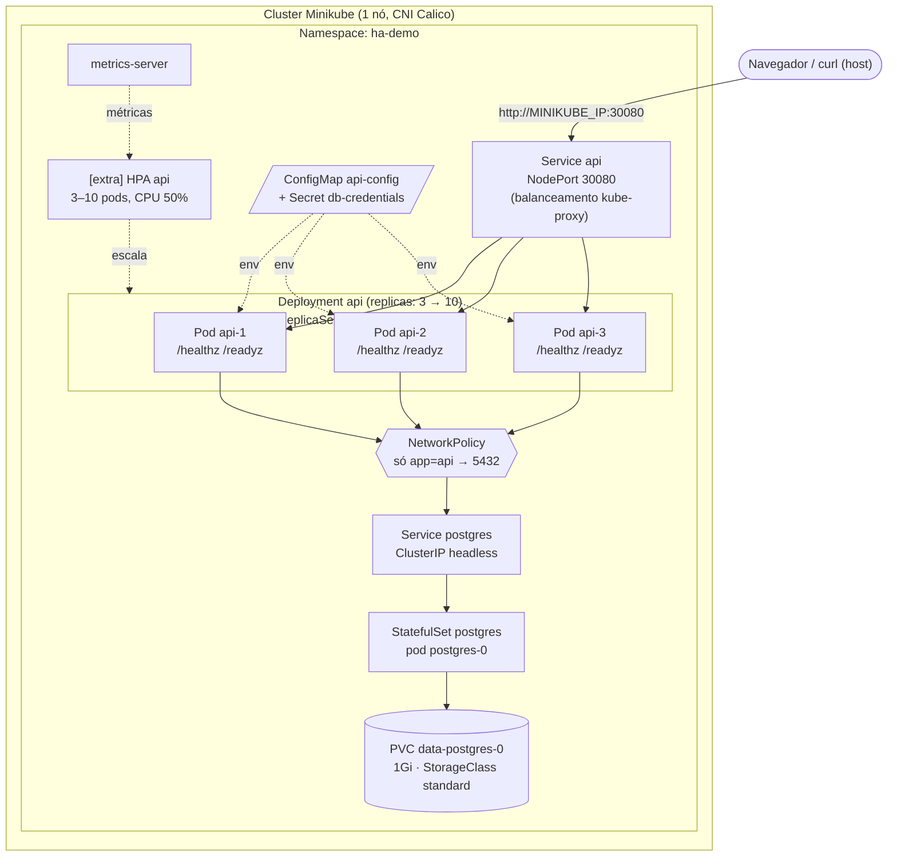
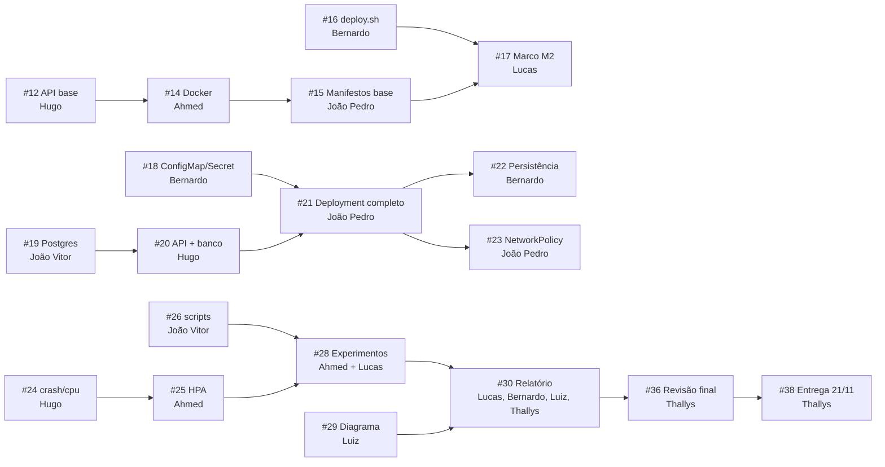

# Plano do trabalho: Prática 5, Orquestração Avançada e Alta Disponibilidade (Kubernetes)

**Disciplina:** Sistemas Operacionais Modernos, Prof. Michel Pires da Silva (CEFET-MG / DECOM)
**Grupo:** G3, Tema 5
**Integrantes:** João Pedro, João Vitor, Ahmed, Bernardo, Luiz, Hugo, Lucas, Thallys
**Entrega:** 21/11/2026. **Apresentação:** 23/11/2026 (até 40 min, live demo)
**Valor:** 10,0 pontos

---

## 1. Resumo executivo

Vamos subir num cluster Kubernetes local (**Minikube**) uma **API web própria (Python/Flask)**. Ela roda com **3 réplicas**, exposta por um **Service NodePort**, e guarda dados num **PostgreSQL com volume persistente**. A configuração fica em **ConfigMap/Secret**, o acesso ao banco é isolado por **NetworkPolicy** e a saúde da API é vigiada por **probes**.

A API responde **qual pod atendeu a requisição**. Com isso a turma vê no navegador o balanceamento, o self-healing e a escala de 3 para 10 pods acontecendo.

O que é **obrigatório** pelo PDF está marcado com **[OBRIGATÓRIO]**. O restante são **extras**, escolhidos pra garantir nota cheia no critério "Configuração do Orquestrador" (3,0 pts). Esse critério cobra *redes, volumes, réplicas, variáveis de ambiente e dependências*, e o mínimo da Prática 5 (Deployment + Service) não cobre tudo isso.

---

## 2. O que o PDF exige (texto base)

| # | Exigência | Fonte |
|---|---|---|
| R1 | Instalar e iniciar um cluster K8s local (Minikube, KinD ou K3s) | Prática 5, item 1 |
| R2 | Manifesto **Deployment** com app web e `replicas: 3` | Prática 5, item 2 |
| R3 | Manifesto **Service** (NodePort ou LoadBalancer) fazendo balanceamento interno e expondo no navegador | Prática 5, item 2 |
| R4 | Validação: acessar no navegador pela porta do Service | Validação |
| R5 | Validação: `kubectl delete pod` e mostrar a recriação ao vivo (self-healing) | Validação |
| R6 | Validação: `kubectl scale deployment <nome> --replicas=10` ao vivo | Validação |
| R7 | Relatório em **LaTeX**: Introdução, Arquitetura (diagrama), Tecnologias, Execução/Validação (prints e logs), Conclusão, Repositório | Seção 3 |
| R8 | Repositório **GitHub** com os YAMLs e o código-fonte | Seção 3, item 6 |
| R9 | Manifestos com redes, volumes, réplicas, variáveis de ambiente e dependências | Critério 1 (3,0) |
| R10 | Demo ao vivo (ou vídeo sem cortes) de até 40 min, na ordem: Arquitetura → Deploy → Validação → Arguição | Seção 5 |
| R11 | Infra base já instalada no notebook antes da apresentação | Seção 5, item 2 |
| R12 | Todos os membros operam o terminal e respondem perguntas | Seção 5, item 4 / Critério 4 |

---

## 3. Decisões de arquitetura (e por quê)

| Decisão | Escolha | Alternativas descartadas | Justificativa |
|---|---|---|---|
| Distribuição K8s | **Minikube** (driver `docker`, 1 nó) | KinD, K3s | É a sugestão principal do PDF, tem a melhor documentação e traz addons prontos (`metrics-server`, `dashboard`, `storage-provisioner`). Com 1 nó não há problema de volume em multi-nó. |
| CNI (rede) | **Calico** (`--cni=calico`) | CNI padrão | A CNI padrão do Minikube **não aplica NetworkPolicy**. Com o Calico, o isolamento de rede funciona de verdade (cobre "redes" do critério 1). |
| Aplicação | **API própria em Python 3.12 + Flask + Gunicorn** | Nginx puro | O Nginx puro não mostra *qual* pod respondeu. Nossa API mostra pod, IP e nó, o que deixa o balanceamento e o self-healing visíveis. Python é a linguagem que o grupo inteiro lê. |
| Exposição | **Service NodePort** (porta fixa `30080`) | LoadBalancer | No Minikube, o LoadBalancer depende de `minikube tunnel` (processo extra e ponto de falha). O NodePort funciona direto em `http://$(minikube ip):30080`. |
| Banco | **PostgreSQL 16 (StatefulSet, 1 réplica) + PVC 1Gi** | Sem banco / Deployment | Cobre "volumes" e "dependências". O StatefulSet é o objeto correto para workload com estado (identidade e volume estáveis). |
| Serviço do banco | **Service ClusterIP headless** (`postgres`) | NodePort | O banco **não** deve ser exposto fora do cluster. Só a API acessa. |
| Configuração | **ConfigMap** (host, nome do banco, mensagem, cor) + **Secret** (usuário e senha) | Variáveis fixas no YAML | Cobre "variáveis de ambiente" e separa configuração de credencial. |
| Dependência API → banco | **initContainer** que espera o Postgres responder na 5432 | `depends_on` (não existe no K8s) | É a forma idiomática de declarar dependência de inicialização no K8s. |
| Saúde | **livenessProbe** (`/healthz`) + **readinessProbe** (`/readyz`) | Sem probes | A liveness dá self-healing **também quando a app trava** (não só quando o pod é deletado). A readiness tira do balanceamento os pods que ainda não estão prontos. |
| Readiness × banco | A readiness **não** depende do banco | Readiness checando o banco | Se o banco cair, a API continua no ar respondendo "banco indisponível", em vez de todos os pods saírem do Service (evita falha em cascata). |
| Recursos | `requests` 100m CPU / 64Mi, `limits` 250m / 128Mi | Sem limites | Liga com o conteúdo de SO (cgroups, contenção). Garante que 10 réplicas cabem no nó e é pré-requisito do HPA. |
| Isolamento | **Namespace `ha-demo`** | `default` | Organização e limpeza fácil (`kubectl delete ns ha-demo`). |
| Rede interna | **NetworkPolicy**: só pods `app=api` acessam `postgres:5432` | Sem política | Mostra isolamento de rede entre componentes. |
| Autoscaling | **HPA** (3 a 10 pods, CPU 50%) como **extra separado** em `extras/` | HPA junto dos manifestos base | Com o HPA ativo, o `kubectl scale --replicas=10` do roteiro obrigatório **seria desfeito** e ele voltaria a 3. Por isso ele só é aplicado **depois** da validação obrigatória. |
| Imagem | Build **dentro do Minikube** (`minikube image build`), tag fixa `api:1.0`, `imagePullPolicy: IfNotPresent` | Docker Hub | Não depende de internet nem de registry na hora da apresentação. |
| Distribuição da carga no navegador | API responde com header `Connection: close` | Padrão keep-alive | O kube-proxy balanceia **por conexão**. Com keep-alive o navegador ficaria preso num pod só. Assim cada requisição pode cair num pod diferente. |
| Aplicação dos manifestos | `kubectl apply -f k8s/` com arquivos numerados | Helm / Kustomize | É simples, transparente e fácil de explicar na arguição. |

---

## 4. Arquitetura



> No relatório, redesenhar esse diagrama no **draw.io** (exportar PDF) ou em **TikZ**.

### Fluxo de dados (decorar para a arguição)
1. O navegador faz a requisição para `IP-do-nó:30080`.
2. O **kube-proxy** (regras iptables/ipvs) escolhe um dos pods *Ready* do Service `api`.
3. O pod da API grava uma visita no Postgres, usando o DNS interno `postgres.ha-demo.svc.cluster.local:5432`.
4. O Postgres persiste os dados no **PVC**, que continua existindo mesmo se o pod morrer.
5. A API responde com HTML/JSON: nome do pod, IP, nó, total de visitas e mensagem do ConfigMap.

---

## 5. Estrutura do repositório (GitHub)

```
k8s-alta-disponibilidade/
├── README.md                      # como rodar em 5 comandos
├── app/
│   ├── app.py                     # API Flask
│   ├── requirements.txt           # flask, gunicorn, psycopg[binary]
│   ├── templates/index.html       # página que mostra o pod (com cor)
│   └── Dockerfile
├── k8s/
│   ├── 00-namespace.yaml
│   ├── 10-configmap.yaml
│   ├── 11-secret.yaml
│   ├── 20-postgres-service.yaml
│   ├── 21-postgres-statefulset.yaml
│   ├── 30-api-deployment.yaml     # [OBRIGATÓRIO] replicas: 3
│   ├── 31-api-service.yaml        # [OBRIGATÓRIO] NodePort 30080
│   └── 40-networkpolicy.yaml
├── extras/
│   └── 50-hpa.yaml                # só aplicado DEPOIS da validação obrigatória
├── scripts/
│   ├── setup-cluster.sh           # minikube start + addons + build da imagem
│   ├── deploy.sh                  # kubectl apply -f k8s/ + rollout status
│   ├── traffic.sh                 # loop de curl mostrando qual pod respondeu
│   ├── measure-selfheal.sh        # mede tempo de recuperação e erros HTTP
│   ├── load-hpa.sh                # gera carga para o HPA
│   └── reset.sh                   # apaga o namespace (volta ao zero)
├── docs/
│   ├── CONTRATOS.md               # nomes, portas, variáveis e formatos
│   ├── CRONOGRAMA.md              # cronograma, fases e marcos
│   ├── FLUXO.md                   # fluxo de trabalho e regras de PR
│   └── PLANO.md                   # este arquivo
└── relatorio/
    ├── main.tex
    ├── secoes/*.tex
    └── figuras/                   # prints das evidências
```

---

## 6. Especificação dos componentes

### 6.1 API (`app/app.py`)
| Rota | Função |
|---|---|
| `GET /` | Página HTML com **nome do pod**, IP, nó, versão, mensagem e cor (ConfigMap) e **total de visitas** (banco). A página faz `fetch('/api/whoami')` a cada 1 s e mostra os pods alternando. |
| `GET /api/whoami` | JSON `{pod, pod_ip, node, version, message, visits, db}`. Registra uma visita no banco (se o banco estiver fora, `db: "indisponível"` e **não** quebra). |
| `GET /healthz` | Liveness: 200, ou 500 se existir o arquivo `/tmp/unhealthy`. |
| `GET /readyz` | Readiness: 200 quando a app terminou de iniciar. |
| `POST /api/crash` | Cria `/tmp/unhealthy`. A liveness falha e o **kubelet reinicia o container** (demo extra de self-healing por travamento). |
| `GET /api/cpu` | Faz cálculo pesado por ~200 ms (carga para o HPA). |

- Nome do pod, IP e nó chegam pela **Downward API** (`metadata.name`, `status.podIP`, `spec.nodeName`).
- Todas as respostas levam o header `Connection: close`.
- Na inicialização a API faz `CREATE TABLE IF NOT EXISTS visits(id serial, pod text, ts timestamptz default now())`.
- Gunicorn: `--workers 2 --threads 2 --bind 0.0.0.0:8080`.

### 6.2 Dockerfile
- Base `python:3.12-slim`, com **usuário não-root**, `EXPOSE 8080` e `CMD gunicorn ...`.
- Build: `minikube image build -t api:1.0 ./app`.

### 6.3 Manifestos: pontos-chave

**`30-api-deployment.yaml`** (núcleo do trabalho):
```yaml
apiVersion: apps/v1
kind: Deployment
metadata:
  name: api
  namespace: ha-demo
  labels: { app: api }
spec:
  replicas: 3                         # [OBRIGATÓRIO]
  selector:
    matchLabels: { app: api }
  strategy:
    type: RollingUpdate
    rollingUpdate: { maxSurge: 1, maxUnavailable: 0 }
  template:
    metadata:
      labels: { app: api }
    spec:
      initContainers:
        - name: wait-for-postgres     # dependência API → banco
          image: busybox:1.36
          command: ["sh", "-c", "until nc -z postgres 5432; do echo aguardando postgres; sleep 2; done"]
      containers:
        - name: api
          image: api:1.0
          imagePullPolicy: IfNotPresent
          ports: [{ containerPort: 8080 }]
          envFrom:
            - configMapRef: { name: api-config }
            - secretRef:    { name: db-credentials }
          env:
            - { name: POD_NAME, valueFrom: { fieldRef: { fieldPath: metadata.name } } }
            - { name: POD_IP,   valueFrom: { fieldRef: { fieldPath: status.podIP } } }
            - { name: NODE_NAME, valueFrom: { fieldRef: { fieldPath: spec.nodeName } } }
          resources:
            requests: { cpu: 100m, memory: 64Mi }
            limits:   { cpu: 250m, memory: 128Mi }
          readinessProbe:
            httpGet: { path: /readyz, port: 8080 }
            initialDelaySeconds: 2
            periodSeconds: 3
          livenessProbe:
            httpGet: { path: /healthz, port: 8080 }
            initialDelaySeconds: 5
            periodSeconds: 5
            failureThreshold: 3
```

**`31-api-service.yaml`:**
```yaml
apiVersion: v1
kind: Service
metadata: { name: api, namespace: ha-demo }
spec:
  type: NodePort                      # [OBRIGATÓRIO]
  selector: { app: api }
  ports:
    - port: 80
      targetPort: 8080
      nodePort: 30080
```

**Demais manifestos:**
| Arquivo | Conteúdo essencial |
|---|---|
| `00-namespace.yaml` | `Namespace ha-demo` |
| `10-configmap.yaml` | `DB_HOST=postgres`, `DB_NAME=appdb`, `APP_VERSION=1.0`, `APP_MESSAGE="Olá, turma de SO!"`, `APP_COLOR=#2e86de` |
| `11-secret.yaml` | `stringData`: `DB_USER=app`, `DB_PASSWORD=<senha-de-demo>` (é credencial de demo. Em produção usaríamos Sealed Secrets ou Vault, bom ponto pra arguição) |
| `20-postgres-service.yaml` | `clusterIP: None`, porta 5432, selector `app=postgres` |
| `21-postgres-statefulset.yaml` | `postgres:16-alpine`, env `POSTGRES_USER/PASSWORD` (do Secret), `POSTGRES_DB` (do ConfigMap), `PGDATA=/var/lib/postgresql/data/pgdata`, readiness `pg_isready`, `volumeClaimTemplates` 1Gi RWO |
| `40-networkpolicy.yaml` | `podSelector app=postgres`, `ingress` somente de `podSelector app=api` na porta 5432 |
| `extras/50-hpa.yaml` | `autoscaling/v2`, `minReplicas 3`, `maxReplicas 10`, CPU `averageUtilization 50` |

---

## 7. Metodologia

- **Iterativa, do obrigatório ao extra.** Primeiro fazemos R1–R6 funcionarem com o mínimo (marco M2). Só depois entram banco, config, rede e HPA. Assim, se algo atrasar, **a nota obrigatória já está garantida**.
- **Tudo versionado no GitHub**, com uma branch por tarefa e Pull Request revisado por **outra dupla**. Isso força todo mundo a ler o código de todo mundo, o que ajuda na arguição.
- **Infra como código.** Nada é feito "na mão" no cluster. Tudo sai de um YAML ou de um script em `scripts/`.
- **Validação experimental medida, não só mostrada.** Para o relatório, cada teste é rodado **5 vezes**, registrando:
  - Self-healing: tempo entre o `delete pod` e o novo pod ficar *Ready*, e número de requisições com erro durante a queda (via `measure-selfheal.sh`, com `curl` a cada 100 ms).
  - Escala: tempo de `kubectl scale --replicas=10` até `10/10 Ready` (`time kubectl rollout status`).
  - Persistência: total de visitas antes e depois de deletar `postgres-0`.
  - Tudo em tabela (média e desvio) no relatório, com prints.
- **Ensaios cronometrados** da apresentação, com rodízio de quem opera o terminal.

---

## 8. Divisão do grupo

> A divisão inicial em 4 duplas foi **substituída** pela divisão individual da **seção 15**, que foi feita por nível de experiência e com carga de horas equilibrada.

**Regra:** **todos os 8** instalam o Minikube na própria máquina e rodam o projeto completo pelo menos uma vez (exigência R12).

---

## 9. Passo a passo (cronograma)

Hoje é 28/09. São 8 semanas até a entrega em 21/11.

### Semana 1 (28/09 – 04/10): Setup
- [ ] D1: criar o repositório GitHub (público ou com o professor como colaborador) e a estrutura de pastas da seção 5.
- [ ] **Todos:** instalar Docker, `kubectl` e `minikube` e rodar:
  ```bash
  minikube start --driver=docker --cni=calico --cpus=4 --memory=6144
  minikube addons enable metrics-server
  kubectl get nodes          # STATUS Ready
  ```
  (Máquina com 8 GB de RAM: usar `--memory=4096`.)
- [ ] D1: escrever `scripts/setup-cluster.sh` e anotar a versão do K8s e do Minikube usada (vai pro relatório).
- [ ] D4: criar o esqueleto LaTeX (template com as 6 seções obrigatórias) no repositório ou no Overleaf.

### Semana 2 (05/10 – 11/10): Aplicação
- [ ] D2: `app.py` com `/`, `/api/whoami`, `/healthz`, `/readyz`, **ainda sem banco**.
- [ ] D2: Dockerfile e teste local com `docker run -p 8080:8080 api:1.0`.
- [ ] D2: `minikube image build -t api:1.0 ./app`.

### Semana 3 (12/10 – 18/10): **Marco M2, o obrigatório funcionando**
- [ ] D3: `00-namespace`, `30-api-deployment` (sem initContainer e sem envFrom por enquanto) e `31-api-service`.
- [ ] D1: `scripts/deploy.sh`.
- [ ] **Validar R4, R5 e R6** (seção 10) e tirar os primeiros prints.
- [ ] **A partir daqui a validação obrigatória já está garantida.**

### Semana 4 (19/10 – 25/10): Estado, configuração e dependência
- [ ] D3: ConfigMap, Secret, Service e StatefulSet do Postgres (com PVC).
- [ ] D2: integrar o banco (tabela `visits`, contador), tratando o banco fora do ar.
- [ ] D3: initContainer, `envFrom`, Downward API, probes e resources no Deployment.
- [ ] Teste: deletar `postgres-0` e conferir que o contador de visitas **se mantém**.

### Semana 5 (26/10 – 01/11): Rede, extras e scripts
- [ ] D3: NetworkPolicy. Testar que um pod qualquer **não** conecta no banco:
  ```bash
  kubectl run intruso --rm -it -n ha-demo --image=busybox:1.36 -- nc -zv -w 2 postgres 5432   # deve falhar
  ```
- [ ] D2: `POST /api/crash` e `GET /api/cpu`.
- [ ] D3: `extras/50-hpa.yaml`. D1: `load-hpa.sh`.
- [ ] D1: `traffic.sh`, `measure-selfheal.sh`, `reset.sh`.
- [ ] Pré-carregar as imagens no Minikube (`postgres:16-alpine`, `busybox:1.36`) para a demo funcionar **sem internet**.

### Semana 6 (02/11 – 08/11): Evidências e relatório
- [ ] D4 com D1: rodar cada experimento 5× e preencher as tabelas de tempo e erro.
- [ ] D4: diagrama final (draw.io exportado em PDF).
- [ ] D4: redigir as seções 1–5 do relatório. **Cada dupla escreve a seção "Tecnologias" da parte que construiu.**
- [ ] Todos: revisão cruzada (cada dupla revisa a seção de outra).

### Semana 7 (09/11 – 15/11): Ensaios
- [ ] D4: `docs/ROTEIRO-DEMO.md` final (seção 11).
- [ ] **Ensaio geral 1** cronometrado, com o professor "simulado" fazendo perguntas da seção 12.
- [ ] **Gravar vídeo sem cortes** da demo completa (plano B, que o PDF aceita).
- [ ] **Ensaio geral 2**, trocando quem opera o terminal.

### Semana 8 (16/11 – 21/11): Fechamento
- [ ] Revisão final do relatório (PDF compilado, link do GitHub na seção 6).
- [ ] Congelar o repositório (tag `v1.0`).
- [ ] **Entregar até 21/11.**
- [ ] 22/11: deixar o notebook de apresentação pronto (cluster no ar, imagens em cache, terminais abertos).
- [ ] **23/11: apresentação.**

---

## 10. Validação: comandos exatos

Variáveis: `NS=ha-demo`, `URL=http://$(minikube ip):30080`.

**Preparação da tela:** tmux ou terminal dividido.
- Painel A: `watch -n1 kubectl get pods -n ha-demo -o wide`
- Painel B: `kubectl get events -n ha-demo -w`
- Painel C: comandos
- Navegador: `$URL`

| Teste | Comando | O que mostrar/explicar |
|---|---|---|
| **R4: Acesso** [OBRIGATÓRIO] | Abrir `$URL` no navegador e rodar `./scripts/traffic.sh` | A página alterna entre os nomes dos 3 pods. Explicar o Service, os Endpoints e o kube-proxy (`kubectl get endpoints api -n ha-demo`). |
| **R5: Self-healing** [OBRIGATÓRIO] | `kubectl delete pod -n ha-demo <um-pod-api>` | No painel A, o pod entra em `Terminating` e um novo aparece `Pending → ContainerCreating → Running`. No painel B, os eventos `Killing` / `SuccessfulCreate`. Explicar o **ReplicaSet controller** e o loop de reconciliação (estado desejado × estado atual). O navegador segue respondendo. |
| **R6: Escala** [OBRIGATÓRIO] | `kubectl scale deployment api -n ha-demo --replicas=10` e depois `kubectl rollout status deployment/api -n ha-demo` | Os 7 pods novos sendo **agendados** (scheduler) e ficando Ready. Mostrar `kubectl top pods -n ha-demo` e a página agora exibindo até 10 pods diferentes. Voltar com `--replicas=3`. |
| Extra: travamento | `curl -X POST $URL/api/crash` | Em cerca de 15 s a liveness falha e a coluna `RESTARTS` do pod vira 1. É o self-healing **sem ninguém deletar nada**. |
| Extra: persistência | Anotar as visitas, rodar `kubectl delete pod postgres-0 -n ha-demo` e aguardar | O StatefulSet recria `postgres-0`, que reanexa o **mesmo PVC**. O contador continua de onde parou. |
| Extra: rede | Comando `intruso` da semana 5 | O `nc` dá timeout: a NetworkPolicy bloqueia quem não é `app=api`. |
| Extra: HPA | `kubectl apply -f extras/50-hpa.yaml`, `./scripts/load-hpa.sh` e `kubectl get hpa -n ha-demo -w` | A CPU passa de 50% e as réplicas sobem sozinhas até 10. Parar a carga: elas voltam a 3 (em ~5 min). |
| Extra: config ao vivo | Editar `APP_MESSAGE`/`APP_COLOR` no ConfigMap, `kubectl apply -f k8s/10-configmap.yaml` e `kubectl rollout restart deployment/api -n ha-demo` | Rolling update sem downtime (`maxUnavailable: 0`), com a cor mudando pod a pod. **É exatamente o tipo de "altere algo ao vivo" que o professor pode pedir.** |

---

## 11. Roteiro da apresentação (40 min)

| Tempo | Etapa (ordem exigida no PDF) | Quem | Conteúdo |
|---|---|---|---|
| 0–8 min | **1. Alinhamento arquitetural** | Luiz, Thallys | Diagrama, papel de cada objeto (Deployment, ReplicaSet, Pod, Service, StatefulSet, PVC, ConfigMap, Secret, NetworkPolicy) e fluxo de dados. |
| 8–13 min | **2. Deploy** | João Vitor, Bernardo | Cluster já no ar: `kubectl get nodes`. Depois `kubectl apply -f k8s/`, `kubectl get all -n ha-demo -w` e explicar o initContainer esperando o Postgres. |
| 13–33 min | **3. Validação** | Lucas, João Pedro, Ahmed, Hugo | R4 → R5 → R6 (obrigatórios, **primeiro**). Depois os extras: crash → persistência → NetworkPolicy → HPA → config ao vivo. Sempre mostrar o estado ocioso antes de cada teste. |
| 33–40 min | **4. Arguição** | Todos | Perguntas. Qualquer um pode ser chamado ao terminal. |

**Plano de contingência:**
- Um segundo notebook com o cluster pronto (D1).
- Imagens em cache (a demo roda sem internet).
- `scripts/reset.sh` seguido de `deploy.sh` recria tudo em ~1 min.
- Vídeo sem cortes gravado na semana 7.
- Se algo falhar, **depurar ao vivo** (`kubectl describe pod`, `kubectl logs`, `kubectl get events`). O PDF diz explicitamente que isso conta ponto.

---

## 12. Preparação para a arguição (todos devem saber)

1. **Pod × container × Deployment × ReplicaSet?** O pod é a menor unidade (1+ containers, mesma rede). O ReplicaSet mantém N pods. O Deployment gerencia ReplicaSets (versões, rolling update).
2. **Como o K8s sabe que um pod caiu?** Os controllers observam o API server (watch). O ReplicaSet controller compara o desejado com o atual e cria o que falta. O kubelet reporta o estado dos containers.
3. **Liveness × readiness?** A liveness reinicia o container. A readiness só tira o pod do balanceamento.
4. **Como o Service balanceia?** O kube-proxy programa iptables/ipvs com os Endpoints dos pods Ready. A distribuição é por conexão, por isso usamos `Connection: close`.
5. **NodePort × LoadBalancer × ClusterIP?** Explicar e justificar a escolha (seção 3).
6. **Por que StatefulSet no banco e não Deployment?** Identidade estável (`postgres-0`) e volume vinculado ao pod.
7. **O que acontece com os dados se o pod do banco morrer?** O PVC continua. O pod novo monta o mesmo volume.
8. **Por que o HPA não fica ligado durante o teste de escala?** Ele sobrescreveria o `replicas: 10` manual.
9. **Relação com SO:** containers são processos isolados por **namespaces** (PID, rede, mount) e limitados por **cgroups** (os `requests`/`limits`). O scheduler do K8s é análogo ao escalonador do SO, só que em escala de cluster.
10. **O que muda num cluster de verdade (vários nós)?** Os pods se espalham entre nós e, se um nó cair, eles são reagendados em outro. O volume precisaria de storage em rede.
11. **Por que o Secret não é seguro "de verdade"?** É só base64. Em produção: criptografia em repouso, RBAC, Sealed Secrets ou Vault.

---

## 13. Relatório LaTeX: conteúdo por seção

| Seção (obrigatória) | Conteúdo | Responsável |
|---|---|---|
| 1. Introdução | Problema (servidor único × cluster), objetivo e visão da solução | D4 |
| 2. Mapeamento da Solução e Arquitetura | Diagrama (seção 4), tabela de objetos K8s, redes (Service, NetworkPolicy, DNS), volumes (PVC) | D4 + D3 |
| 3. Tecnologias Utilizadas | Papel de cada componente: Minikube, Calico, kubelet/kube-proxy/scheduler, API, Postgres, metrics-server/HPA | Cada dupla, sua parte |
| 4. Execução e Validação Experimental | Passo a passo com **prints e logs** de R4, R5, R6 e extras, mais as tabelas de medições (média e desvio de 5 execuções) | D4 + D1 |
| 5. Conclusão | Aprendizados, dificuldades, trabalhos futuros (multi-nó, Ingress, CI/CD) | Todos |
| 6. Repositório | Link do GitHub e tag `v1.0` | D1 |

---

## 14. Checagem final: conformidade com o PDF

| Requisito do PDF | Atendido? | Onde no plano |
|---|---|---|
| R1: cluster local (Minikube/KinD/K3s) | Sim: Minikube | Seções 3 e 9 (S1) |
| R2: Deployment com app web, `replicas: 3` | Sim | Seção 6.3 (`replicas: 3`) |
| R3: Service NodePort/LoadBalancer com balanceamento interno e acesso no navegador | Sim: NodePort 30080 | Seção 6.3 |
| R4: acessar no navegador pela porta do Service | Sim | Seção 10 |
| R5: `kubectl delete pod` com recriação mostrada em tempo real | Sim: `watch` + eventos | Seção 10 |
| R6: `kubectl scale ... --replicas=10` ao vivo | Sim: (HPA desligado nesse momento) | Seções 3 e 10 |
| R7: relatório LaTeX com as 6 seções | Sim | Seção 13 |
| R8: GitHub com YAMLs e código | Sim | Seção 5 |
| R9: redes / volumes / réplicas / env / dependências | Sim: NetworkPolicy + Services / PVC / replicas / ConfigMap + Secret / initContainer | Seções 3 e 6.3 |
| R10: ordem da apresentação e 40 min | Sim: 8 + 5 + 20 + 7 min | Seção 11 |
| R11: infra pré-instalada antes da apresentação | Sim | Seções 9 (S8) e 11 |
| R12: todos operam o terminal / arguição | Sim: todos instalam, rodízio nos ensaios, lista de perguntas | Seções 8, 9 e 12 |
| Datas: entrega 21/11, apresentação 23/11 | Sim | Seção 9 |

**Pontos de atenção identificados:**
- **HPA × `kubectl scale`:** resolvido deixando o HPA em `extras/`, aplicado só depois do R6.
- **Navegador preso num pod** (keep-alive): resolvido com `Connection: close` e o `traffic.sh` com curl.
- **NetworkPolicy ignorada** na CNI padrão: resolvido com `--cni=calico`.
- **Falta de internet na sala:** resolvido com imagens pré-carregadas no Minikube.
- **Falha em cascata se o banco cair:** resolvido com a readiness independente do banco.

**Conclusão da checagem:** todos os requisitos obrigatórios da Prática 5, do relatório e da dinâmica de apresentação estão cobertos. Os extras reforçam o critério 1 (3,0 pts) e a arguição (1,5 pts) sem colocar o obrigatório em risco, porque o marco M2 (semana 3) garante o obrigatório antes de qualquer extra.

---

## 15. Divisão de tarefas por integrante

### 15.1 Critérios da divisão
- **Nível técnico:**
  - **Nível 1 (João Pedro, Hugo):** ficam com as tarefas mais difíceis, que formam o núcleo técnico (manifestos, dependências, rede, integração da API com o banco).
  - **Nível 2 (João Vitor, Ahmed, Lucas):** ficam com as tarefas complexas (Postgres/StatefulSet, scripts de medição, HPA, experimentos, validação).
  - **Nível 3 (Bernardo, Luiz, Thallys):** ficam com as tarefas simples (configuração, testes guiados, diagrama, relatório, entrega).
- **Tempo equilibrado:** cada pessoa tem **~12,5 a 13 h** de trabalho estimado, contando a instalação do ambiente (2 h). As atividades em grupo (2 ensaios e a apresentação) valem para todos e não entram na conta.
- **Coerência:** quem constrói uma parte também apresenta e escreve sobre ela. Isso ajuda muito na arguição.
- **Onde ver:** cada issue tem o responsável no topo e o Project tem os campos **Responsável** e **Horas (est.)**. As atribuições oficiais no GitHub serão feitas com `.github/atribuir-issues.sh` quando todos aceitarem o convite.

### 15.2 Resumo

| Integrante | GitHub | Nível | Papel | Issues | Horas |
|---|---|---|---|---|---|
| João Pedro | @JohnPss | 1 | Coordenação + núcleo K8s | #15, #21, #23 | 13 h |
| Hugo | @hugnarok | 1 | Aplicação (API + banco) | #12, #20, #24 | 13 h |
| João Vitor | @joaovitor3105 | 2 | Infra, Postgres e scripts | #10, #19, #26, #37 | 12,5 h |
| Ahmed | @HachemAhmed | 2 | Docker, HPA e medições | #14, #25, #28, #39 | 13 h |
| Lucas | @Lucas-Roseno | 2 | Validação e roteiro da demo | #17, #28, #30 (Validação), #32 | 13 h |
| Bernardo | @BernardoSilvaAndrade | 3 | Página web, config e testes | #13, #16, #18, #22, #30 (Tecnologias) | 13 h |
| Luiz | @LuizFernandosq | 3 | Relatório (base) e diagrama | #11, #27, #29, #30 (Arquitetura), #31 | 12,5 h |
| Thallys | @Thallys-Lamounier | 3 | Relatório (texto final) e entrega | #30 (Intro/Conclusão), #31, #34, #36, #38 | 13 h |
| **Todos** | | | Instalação, ensaios e apresentação | #2, #33, #35, #40 | 2 h cada na #2 (já somadas acima) |

### 15.3 Detalhamento por pessoa

#### João Pedro (@JohnPss): coordenação + núcleo Kubernetes (13 h)
| Issue | Tarefa | Semana | Complex. | Horas |
|---|---|---|---|---|
| #2 | Instalar ambiente local (sua parte do checklist) | S1 | Simples | 2 |
| #15 | Manifestos base: Namespace, Deployment `replicas: 3`, Service NodePort | S3 | Difícil | 4 |
| #21 | Deployment completo: initContainer, envFrom, Downward API, probes, resources | S4 | Difícil | 4 |
| #23 | NetworkPolicy (Calico) e teste do pod intruso | S5 | Difícil | 3 |

- **Também:** revisar os PRs de manifestos, destravar quem estiver bloqueado e acompanhar o Board toda semana.
- **Depende de:** #12/#14 (imagem da API) para a #15, e #18/#19 para a #21.
- **Na apresentação:** self-healing (R5), liveness e NetworkPolicy.

#### Hugo (@hugnarok): aplicação (13 h)
| Issue | Tarefa | Semana | Complex. | Horas |
|---|---|---|---|---|
| #2 | Instalar ambiente local (sua parte do checklist) | S1 | Simples | 2 |
| #12 | API Flask base (`/`, `/api/whoami`, `/healthz`, `/readyz`, `Connection: close`) | S2 | Média | 4 |
| #20 | Integrar API com Postgres (tabela `visits`, tolerância a falha, readiness independente do banco) | S4 | Difícil | 5 |
| #24 | Endpoints `/api/crash` e `/api/cpu` | S5 | Média | 2 |

- **Também:** dar suporte ao Bernardo na página HTML (#13) e ao Ahmed no Dockerfile (#14).
- **Na apresentação:** crash e liveness, e a config ao vivo (rolling update com a cor mudando).

#### João Vitor (@joaovitor3105): infra, Postgres e scripts (12,5 h)
| Issue | Tarefa | Semana | Complex. | Horas |
|---|---|---|---|---|
| #2 | Instalar ambiente local (sua parte do checklist) | S1 | Simples | 2 |
| #10 | `setup-cluster.sh` e registro de versões | S1 | Média | 2 |
| #19 | Postgres: Service headless + StatefulSet + PVC | S4 | Difícil | 4 |
| #26 | Scripts `traffic.sh`, `measure-selfheal.sh`, `reset.sh` | S5 | Média | 4 |
| #37 | Tag v1.0 e congelar repositório | S8 | Simples | 0,5 |

- **Também:** ajudar os colegas na instalação do Minikube (S1).
- **Na apresentação:** deploy ao vivo (`kubectl apply`, initContainer esperando o Postgres).

#### Ahmed (@HachemAhmed): Docker, HPA e medições (13 h)
| Issue | Tarefa | Semana | Complex. | Horas |
|---|---|---|---|---|
| #2 | Instalar ambiente local (sua parte do checklist) | S1 | Simples | 2 |
| #14 | Dockerfile (não-root) e build no Minikube | S2 | Média | 2 |
| #25 | HPA em `extras/` e `load-hpa.sh` | S5 | Difícil | 3 |
| #28 | Experimentos 5× e tabelas (responsável principal) | S6 | Média | 4 |
| #39 | Preparar o notebook da apresentação (e o reserva) | Apres. | Média | 2 |

- **Na apresentação:** escala 3 → 10 (R6) e HPA.

#### Lucas (@Lucas-Roseno): validação e roteiro da demo (13 h)
| Issue | Tarefa | Semana | Complex. | Horas |
|---|---|---|---|---|
| #2 | Instalar ambiente local (sua parte do checklist) | S1 | Simples | 2 |
| #17 | Marco M2: validar R4, R5, R6 e primeiros prints | S3 | Média | 3 |
| #28 | Experimentos 5× (apoio: conferir e montar gráficos/tabelas) | S6 | Média | 1 |
| #30 | Relatório: seção **Execução e Validação Experimental** | S6 | Média | 4 |
| #32 | Roteiro final da demo (`docs/ROTEIRO-DEMO.md`) | S7 | Média | 3 |

- **Também:** conduzir os ensaios (#33, #35) com o roteiro em mãos e cronometrar.
- **Na apresentação:** abertura da validação (R4, com o navegador alternando entre os pods) e condução do roteiro.

#### Bernardo (@BernardoSilvaAndrade): página web, config e testes (13 h)
| Issue | Tarefa | Semana | Complex. | Horas |
|---|---|---|---|---|
| #2 | Instalar ambiente local (sua parte do checklist) | S1 | Simples | 2 |
| #13 | Página HTML com auto-refresh e cor do ConfigMap | S2 | Simples | 3 |
| #16 | Script `deploy.sh` | S3 | Simples | 1 |
| #18 | ConfigMap e Secret | S4 | Simples | 1,5 |
| #22 | Teste de persistência (deletar `postgres-0`) + prints | S5 | Simples | 1,5 |
| #30 | Relatório: seção **Tecnologias Utilizadas** | S6 | Simples | 4 |

- **Na apresentação:** deploy junto com o João Vitor, e demo de persistência.

#### Luiz (@LuizFernandosq): relatório (base) e diagrama (12,5 h)
| Issue | Tarefa | Semana | Complex. | Horas |
|---|---|---|---|---|
| #2 | Instalar ambiente local (sua parte do checklist) | S1 | Simples | 2 |
| #11 | Esqueleto do relatório LaTeX (6 seções) | S1 | Simples | 2 |
| #27 | Pré-carregar imagens (demo offline) | S5 | Simples | 1,5 |
| #29 | Diagrama final da arquitetura (draw.io) | S6 | Simples | 3 |
| #30 | Relatório: seção **Mapeamento da Solução e Arquitetura** | S6 | Simples | 3 |
| #31 | Revisão cruzada (revisa as seções do Lucas e do Thallys) | S6 | Simples | 1 |

- **Na apresentação:** alinhamento arquitetural (diagrama e papel de cada objeto).

#### Thallys (@Thallys-Lamounier): relatório (texto final) e entrega (13 h)
| Issue | Tarefa | Semana | Complex. | Horas |
|---|---|---|---|---|
| #2 | Instalar ambiente local (sua parte do checklist) | S1 | Simples | 2 |
| #30 | Relatório: **Introdução** e **Conclusão** | S6 | Simples | 3,5 |
| #31 | Revisão cruzada (revisa as seções do Luiz e do Bernardo) | S6 | Simples | 1 |
| #34 | Gravar vídeo sem cortes (plano B) | S7 | Simples | 2 |
| #36 | Revisão final e compilação do relatório | S8 | Média | 4 |
| #38 | Entrega do trabalho (21/11) | S8 | Simples | 0,5 |

- **Na apresentação:** alinhamento arquitetural (introdução do problema e fluxo de dados), junto com o Luiz.

#### Todos
| Issue | Atividade | Data |
|---|---|---|
| #2 | Instalar ambiente local (checklist com os 8 nomes; cada um comenta seu print) | até 04/10 |
| #33 | Ensaio geral 1 + arguição simulada | 11/11 |
| #35 | Ensaio geral 2 com rodízio no terminal | 14–15/11 |
| #40 | Apresentação (live demo) | 23/11 |

- **Estudar** a seção 12 (perguntas da arguição). Qualquer um pode ser chamado ao terminal.
- Comentar em pelo menos **um PR** de outra pessoa por semana (a aprovação é do João Pedro ou do Hugo).

### 15.4 Cadeia de dependências (quem espera quem)



---

## 16. Fluxo de desenvolvimento e autonomia

- **Cada issue é autossuficiente:** objetivo, por que importa, o que você vai aprender, dependências (bloqueada por / bloqueia), como começar sem esperar, entregáveis, passo a passo, como testar, critério de pronto, material de apoio, dicas e quem aprova.
- **Contratos:** [`CONTRATOS.md`](CONTRATOS.md) fixa nomes, portas, variáveis, rotas, formato de CSV e arquivos do relatório. Com isso cada um trabalha em paralelo usando mocks e stubs, sem esperar ninguém.
- **Fluxo:** [`FLUXO.md`](FLUXO.md) descreve o ciclo branch → PR → aprovação → merge, o ritmo semanal e o que fazer quando travar.
- **Regras obrigatórias no GitHub** (issue #42):
  - a `main` é protegida por ruleset, sem push direto;
  - toda branch nasce de uma issue aberta (`N-descricao`), o que é checado pela Action `regras-do-pr`;
  - o merge só acontece com aprovação do **João Pedro ou do Hugo** (`CODEOWNERS`);
  - o merge é sempre squash.
- **Dependências nativas do GitHub:** cada issue mostra "Blocked by" na lateral. Todas as tarefas bloqueadas têm uma alternativa para começar antes.
- **Instalação condensada:** as antigas #3–#9 foram fechadas como duplicadas da **#2**, que agora é uma issue só para os 8, com checklist por pessoa.
- **Ajustes de calendário feitos na análise:**
  - #22 (persistência) foi para a **S5** (26–27/10), porque depende da #21, que termina em 25/10.
  - #30 (redação) termina em **07/11**.
  - #31 (revisão cruzada) fica em **08/11**, para não revisar texto inacabado.

### Caminho crítico
`#12 API` → `#14 Docker` → `#15 manifestos` → `#17 Marco M2` (obrigatório garantido em 18/10)
`#19 Postgres` → `#20 API+banco` → `#21 Deployment completo` → `#28 experimentos` → `#30 relatório` → `#31` → `#36` → `#38 entrega`

Atrasos nessas issues atrasam o grupo inteiro. Elas estão com os níveis 1 e 2 por isso.
